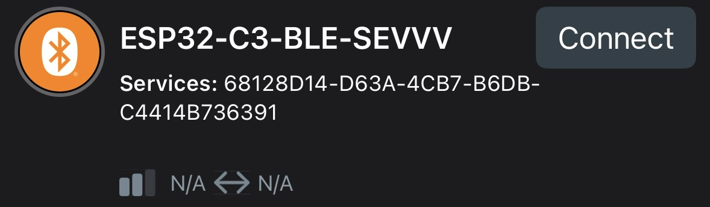
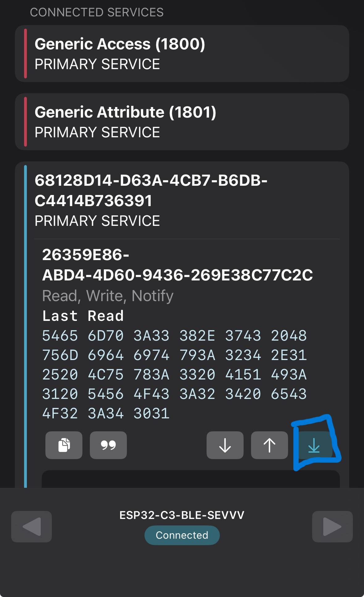
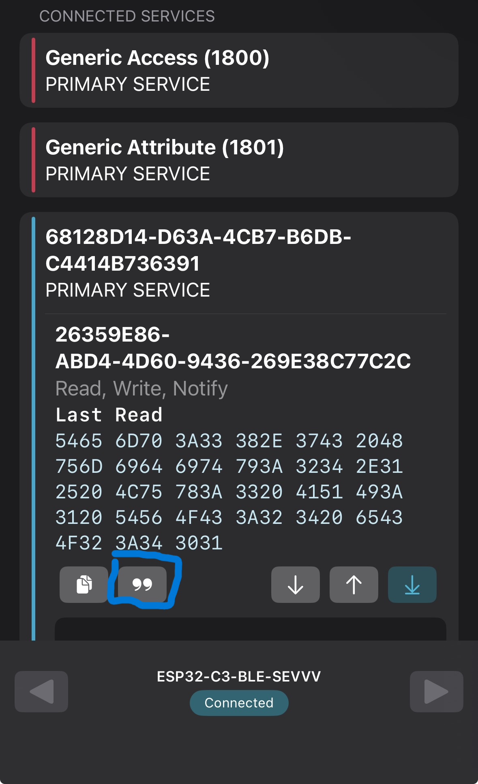
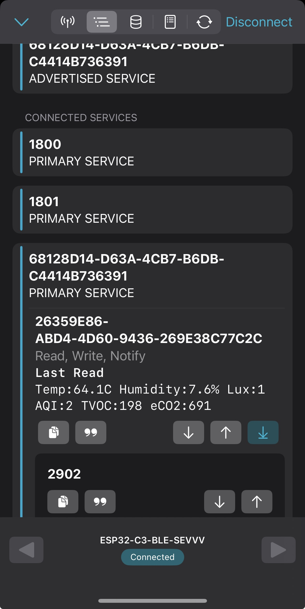

**1.** Alimenter le dispositif par USB-C ou par la batterie.

**2.** Installer et ouvrir nRF Connect for Mobile sur un téléphone compatible.

**3.** Rechercher le périphérique BLE nommé ESP32-C3-BLE-SEVVV.

**4.** Se connecter au périphérique, puis activer la reception de donner comme ci:

**5.** Activer maintenant la décryption de donner comme ci:

**6.** Vous devriez avoir un résultat similaire à ceci:
