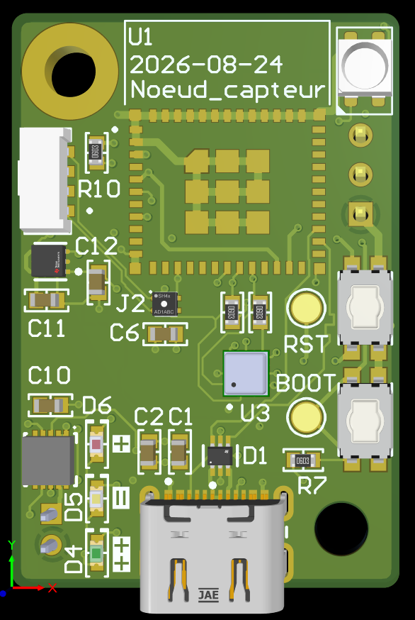
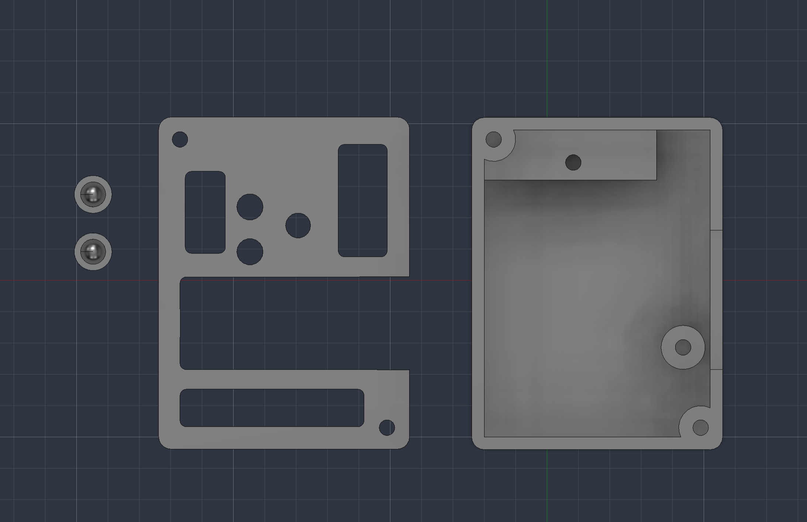

# CI3-Noeud-de-capteur-

Projet éffectué par: Bruno Savard et William Champagne

Ce projet consiste à concevoir un PCB avec des capteurs environnementaux. Ces capteurs permettent de recueillir des informations telles que la luminosité, l’humidité, la qualité de l’air et la température ambiante d’une pièce. Le tout doit être intégré dans un boîtier compact afin de pouvoir facilement le déplacer et l’utiliser dans différents environnements.

## Requis électriques
- ESP32-C3-WROOM-02-N4 (MCU)
- ENS160-BGLM (capteur de qualité de l’air)
- SHT41AD1B-R2 (capteur de température et d’humidité)
- VEML7700 (capteur d’éclairement lumineux)
- Alimentation et programmation USB-C (5 V)
- DEL NeoPixel 3535 (diagnostic/état global)
- Bouton RESET (MCU)

## Requis informatiques
- Interface des trois capteurs par bus I²C
- Programmation par USB-C
- Plateforme Arduino
- Plan de test du logiciel

## Requis mécaniques
- PCB de 50 × 50 mm
- Vis M3
- Boîtier
- Accès aux capteurs et au port USB-C
- Accès au bouton RESET à l’extérieur du boîtier
- Boîtier compact et robuste

## Requis optionnels
- Batterie LiPo
- MOSFET PMOS (gestion de l’alimentation USB ou batterie)
- Connecteur B2B-PH-K-S (si LiPo)
- Circuit de recharge MCP73833-FCI/MF (si LiPo)
- PDT DFT

### Matériel
**1.** Boitier

**2.** PCB    

### Logiciel
**1.** VsCode
    - Extension PlatformIO
        - Librairie de capteur: "Adafruit_VEML7700.h", "ScioSense_ENS160.h"
        - Librairie bluetooth: <BLEDevice.h>, <BLEUtils.h>, <BLEServer.h>, <BLE2902.h>

**1.** Altium -> PCB 
    - Librairie Celestial utilisée
    - Librairie étudiante utilisée

**3.** Fusion 360 -> Modèle 3D 

### Limitations
Le prototype actuel est limité à un affichage par port série ou bluetooth.

## Structure

### 3DModels
Cette section regroupe les [modèles 3D](<3DModels/>) nécessaires pour la fabrication et la manufacturation du PCB et du support associé à ce même PCB.

**1.** Modèle 3D de la [carte du PCB.](<3DModels/>)

**2.** Modèle 3D du [support](<3DModels/>) pour la carte du tableau de bord et le raspberry pi. 

### Code
Cette section contient les fichiers code du [ESP32](<Code/>)
- #### ESP32

**main.cpp** Code gérant l'obtention des données des capteurs et la communication avec le port série ou bluetooth. Se trouve dans: `Code/CI3_NoeudCapteurs_WCBS/src`

### Datasheets
Cette section contient les diverses [datasheets](<Datasheets/>) utilisées pour la conception du schéma électrique. 

### Journal

Cette section contient le [journal](<Journal/>) de bord, le cahier des charges ainsi que le post mortem.

### PCB
Cette [section](<PCB/>) contient le pdf de projet du PCB, des images du PCB ainsi que les fichiers de projet.     

### Plan de test
- Plan de test électrique, informatique et mécanique complétés.

### Schéma
La section ["Schematics"](<Schematics/>) du dépôt github contient les schémas suivant : 

**1.** Schéma de concept 

**2.** Schéma électrique 

**3.** Ordinogramme 

### Guides
Cette section contient les [guides](<Guides/>) pour utilisateur et développeur.

#### Pour un utilisateur
Voir [Guide d'utilisateur](<Guides/guide_user.md>)

#### Pour un developpeur
Voir [Guide de développement](<Guides/guide_dev.md>)
